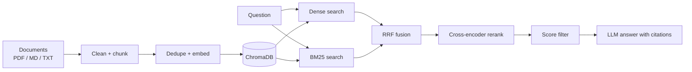

# hybrid-rag-engine

A hybrid Retrieval-Augmented Generation (RAG) pipeline in pure Python. It focuses on retrieval quality, runs fully locally with no API keys, and ships with an evaluation harness so every tuning change is measured.

## Features

- **Structure-aware chunking:** Markdown headings and file names are kept as context in every chunk
- **Hybrid retrieval:** dense vectors (ChromaDB) combined with BM25 keyword search
- **Reciprocal Rank Fusion (RRF):** merges both rankings without needing comparable scores
- **Cross-encoder reranking** with a score threshold, so weak matches are dropped and the system can say "I don't know"
- **Grounded answers** with numbered source citations, using a local LLM via Ollama
- **Evaluation harness:** hit@k, MRR and abstain rate, with answer-text checks and out-of-scope questions
- **Threshold calibration:** picks the rerank cut-off from your eval set
- **Interactive chat:** shows retrieved chunks and scores for live testing
- **Pluggable generator interface** for swapping Ollama for Bedrock or Azure OpenAI
- **Lightweight tracing:** per-stage timings and one summary log line per query

## Architecture



## Quick start

Requires Python 3.10+ and [Ollama](https://ollama.com).

```bash
git clone https://github.com/krish21venkat-skills/hybrid-rag-engine.git
cd hybrid-rag-engine
python -m venv .venv
.venv\Scripts\activate          # macOS/Linux: source .venv/bin/activate
pip install -e ".[dev]"
ollama pull llama3.1
```

Put documents (PDF, MD, TXT) in `data/docs/`, then run:

```bash
hybridrag ingest data/docs                  # first run downloads the embedding and reranker models
hybridrag search "your question"            # retrieval only
hybridrag ask "your question"               # full grounded answer
hybridrag chat                              # interactive Q&A showing sources and scores
hybridrag eval eval/questions.jsonl         # measure retrieval quality
hybridrag calibrate eval/questions.jsonl    # recommend a rerank score threshold
```

Use `--log DEBUG` for more detail, for example `hybridrag --log DEBUG ask "..."`.

## Configuration

Defaults are in `src/hybridrag/config.py`. Override them in `config/settings.yaml`, and override those with `RAG_<NAME>` environment variables (for example `RAG_TOP_K=7`).

| Setting | Default | Purpose |
|---|---|---|
| `embed_model` | `BAAI/bge-small-en-v1.5` | Embedding model |
| `rerank_model` | `BAAI/bge-reranker-base` | Cross-encoder reranker |
| `llm_model` | `llama3.1:latest` | Ollama model |
| `chunk_size` / `chunk_overlap` | 1000 / 150 | Characters per chunk / overlap |
| `top_k` | 5 | Chunks sent to the LLM |
| `min_rerank_score` | 0.05 | Drop matches scoring below this |

Changing the chunking or embedding settings requires deleting `storage/` and re-ingesting.

## Evaluation

Each line of `eval/questions.jsonl` is a test case:

```json
{"question": "What is the hotel limit for contractors?", "source": "ContractorPolicy.txt", "answer_contains": "3,500"}
{"question": "What is the CEO's salary?", "source": null}
```

A question counts as a hit only if a chunk from the right file is retrieved **and** it contains the expected answer text. Questions with `"source": null` are out of scope, so the correct behaviour is returning no results.

### Results

24 answerable and 3 out-of-scope questions:

| Run | Change | hit@5 | MRR | Abstain rate |
|---|---|---|---|---|
| 1 | Baseline (chunk 1000/150, `min_rerank_score` 0.05) | 0.958 | 0.917 | 1.0 |
| 2 | chunk 1000/150, threshold 0.02 | 1.000 | 0.958 | 1.0 |

The single miss in run 1 was a valid question ("hotel limit for employees in metro cities") whose chunk scored below the cut-off and was rejected. Inspecting the scores with the threshold set to 0 showed this, and the run 2 change fixed it without letting any out-of-scope question through.

**Caveat:** the out-of-scope set has only 3 questions, so the abstain rate is indicative, not conclusive.

### Threshold calibration

A fixed cut-off either blocks valid answers or lets out-of-scope questions through. `hybridrag calibrate` scores every eval question with the threshold off and recommends the value that best separates correct chunks from out-of-scope matches. If the two score ranges overlap, no threshold can fix it, and chunking needs work instead.

## Project structure

```
hybrid-rag-engine/
├── pyproject.toml
├── config/settings.yaml
├── data/docs/                 # sample documents (fictional)
├── eval/questions.jsonl
├── docs/RUNBOOK.md            # runbook and project notes
├── src/hybridrag/
│   ├── config.py              # settings: defaults < YAML < env vars
│   ├── loaders.py             # PDF / MD / TXT loading
│   ├── chunking.py            # cleaning + structure-aware chunking
│   ├── embeddings.py          # sentence-transformers wrapper
│   ├── store.py               # ChromaDB vector store
│   ├── retrieval.py           # dense + BM25 + RRF + rerank
│   ├── generation.py          # Generator interface + Ollama implementation
│   ├── pipeline.py            # wires the stages together
│   ├── evaluate.py            # hit@k, MRR, abstain rate
│   ├── calibrate.py           # threshold calibration
│   ├── logging_utils.py
│   └── cli.py                 # hybridrag command
└── tests/
```

The core library contains no cloud or UI code. Integrations belong in thin entry points that call `RAGPipeline().ask(...)`.

## Technologies

Python, ChromaDB, sentence-transformers (BGE embedding and reranker models), rank_bm25, LangChain text splitters, pypdf, Ollama (Llama 3.1), PyYAML, pytest.

## Roadmap

- [x] Hybrid retrieval, reranking and an eval harness
- [x] Eval-driven threshold calibration
- [ ] LangGraph agentic flow (query rewriting, retry, fallback)
- [ ] Bedrock and Azure OpenAI generators
- [ ] FastAPI endpoint for HTTP and UiPath integration
- [ ] Parent-child chunking and metadata filters

## Tests

```bash
pytest -q
```

## License

MIT